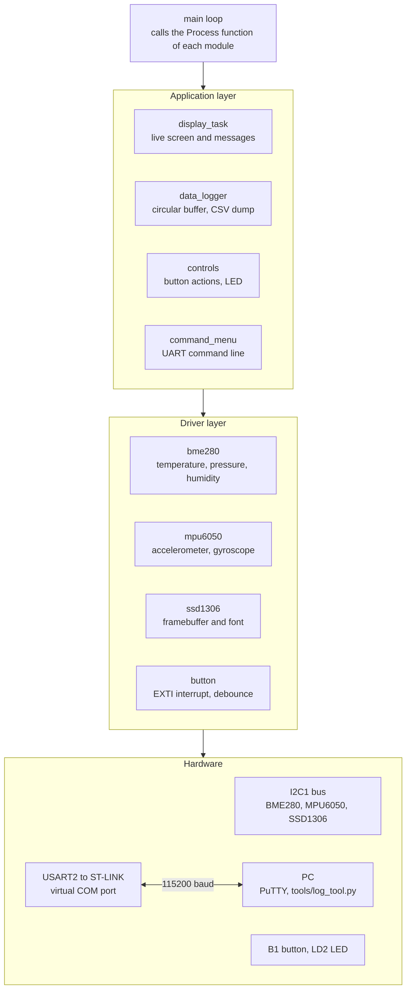
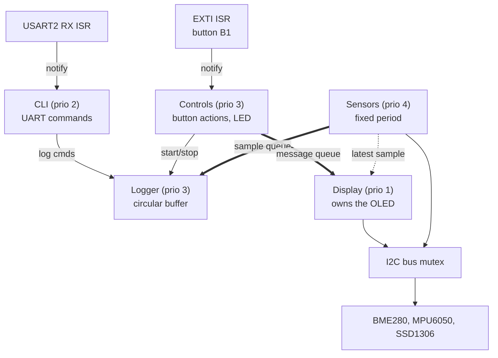

# STM32 Sensor Data Logger

Firmware για board STM32 Nucleo-64 (NUCLEO-F401RE) που διαβάζει τον αισθητήρα περιβάλλοντος BME280 και το IMU MPU6050 μέσω I2C, εμφανίζει τις μετρήσεις σε οθόνη OLED SSD1306, καταγράφει τα δεδομένα σε buffer με timestamps και προσφέρει διαδραστικό command interface πάνω από UART. Ένα Python εργαλείο στον υπολογιστή κατεβάζει τις καταγραφές, τις αποθηκεύει σε CSV και φτιάχνει γραφήματα.

Γραμμένο σε C με το STM32 HAL, με κάθε περιφερειακό σε δικό του driver module. Είναι project εκμάθησης και portfolio που χτίστηκε βήμα-βήμα.

## Demo


Σύντομο πάτημα του κουμπιού B1 ξεκινά την καταγραφή (το LD2 ανάβει), οι μετρήσεις ανανεώνονται ζωντανά στην οθόνη, και στο τέλος τα δεδομένα κατεβαίνουν στον υπολογιστή ως CSV με γράφημα.

## Hardware

| Εξάρτημα | Ρόλος | Διεύθυνση I2C (7-bit) |
|---|---|---|
| NUCLEO-F401RE (ARM Cortex-M4) | Κύριο board, ενσωματωμένος ST-LINK debugger και virtual COM port | |
| BME280 (module HW-611) | Θερμοκρασία, υγρασία, πίεση | `0x76` |
| MPU6050 | Επιταχυνσιόμετρο και γυροσκόπιο 3 αξόνων | `0x68` |
| SSD1306 OLED 128x64 | Τοπική οθόνη μετρήσεων | `0x3C` |
| Logic analyzer 8 καναλιών (Saleae-compatible, 24 MHz) | Debugging πρωτοκόλλων με PulseView/sigrok | |

## Καλωδίωση


Και τα τρία modules μοιράζονται το ίδιο I2C bus (I2C1, 100 kHz, με pull-ups πάνω στα modules).

| Σήμα | Pin Nucleo | Πηγαίνει σε |
|---|---|---|
| SCL | PB8 (D15) | SCL όλων των modules |
| SDA | PB9 (D14) | SDA όλων των modules |
| 3V3 | 3.3V | VCC όλων των modules |
| GND | GND | GND όλων των modules |

Pins διευθύνσεων: BME280 `SDO` στο GND (0x76) και `CSB` στο 3V3 (λειτουργία I2C). MPU6050 `AD0` στο GND (0x68).

Άλλα pins που χρησιμοποιούνται: `LD2` στο PA5 (LED καταγραφής), `B1` στο PC13 (user button, interrupt) και USART2 στα PA2/PA3 (ST-LINK virtual COM port, 115200 8N1).

## Δομή του project

```
Core/
  Inc/   main.h, command_menu.h, bme280.h, mpu6050.h, ssd1306.h, ssd1306_font.h,
         display_task.h, data_logger.h, button.h, controls.h, sensor_task.h, i2c_bus.h, app_config.h
  Src/   main.c, command_menu.c, bme280.c, mpu6050.c, ssd1306.c,
         display_task.c, data_logger.c, button.c, controls.c, sensor_task.c, i2c_bus.c
Drivers/            (παράγονται αυτόματα: STM32 HAL και CMSIS)
tools/              (log_tool.py, requirements.txt)
docs/               (screenshots, captures, παράδειγμα γραφήματος)
*.ioc               (ρυθμίσεις STM32CubeMX)
```

### Διάγραμμα αρχιτεκτονικής



Αρχιτεκτονική σε επίπεδα:
- **Drivers**: `bme280`, `mpu6050`, `ssd1306`, `button`. Μιλούν απευθείας με το hardware.
- **Εφαρμογή**: `display_task` (ζωντανή οθόνη), `data_logger` (κυκλικός buffer), `controls` (ενέργειες του κουμπιού), `command_menu` (UART).
- Το κύριο loop καλεί τις `*_Process()` συναρτήσεις η μία μετά την άλλη, χωρίς blocking delays, και τα interrupts (UART RX, κουμπί) δεν χάνουν γεγονότα όσο το loop είναι απασχολημένο.

## Έκδοση FreeRTOS

Το super-loop αντικαταστάθηκε από tasks του FreeRTOS (CMSIS-RTOS v2, HAL timebase στο TIM11, heap 32 KB).



| Task | Προτεραιότητα | Stack (words) | Ρόλος |
|------|:---:|:---:|-------|
| Sensors | 4 | 256 | Διαβάζει BME280 και MPU6050 με σταθερή περίοδο (deadline-based) |
| Logger | 3 | 192 | Καταναλωτής της ουράς δειγμάτων, κυκλικός buffer 1024 εγγραφών |
| Controls | 3 | 192 | Ξυπνά από το interrupt του B1, σύντομο/μακρύ πάτημα |
| CLI | 2 | 256 | Επεξεργασία εντολών UART |
| Display | 1 | 256 | Μοναδικός ιδιοκτήτης του framebuffer και της οθόνης |

Σχεδιαστικές αποφάσεις:
- **Task notifications από ISR** (`vTaskNotifyGiveFromISR`) για το κουμπί και το UART: χωρίς polling και χωρίς χαμένα γεγονότα.
- **Ουρά δειγμάτων** (16 θέσεις) από το Sensors στο Logger, με μετρητή για δείγματα που χάνονται.
- **Mutex στο I2C bus** (`i2c_bus.c`): τρία devices μοιράζονται το ίδιο bus από διαφορετικά tasks.
- **Μία οθόνη, ένα task**: οι άλλοι στέλνουν μηνύματα μέσω ουράς, χωρίς blocking.
- Οι προτεραιότητες των interrupts (USART2, EXTI) είναι χαμηλότερης επείγουσας από το όριο του FreeRTOS, ώστε να επιτρέπονται οι κλήσεις `...FromISR`.

### Μετρήσεις

Jitter της περιόδου δειγματοληψίας, 50 ms, 40 s καταγραφή:

| | mean | std | min | max |
|---|---:|---:|---:|---:|
| Super-loop | 55.6 ms | 22.9 ms | 50 ms | 150 ms |
| FreeRTOS | 50.0 ms | 0.0 ms | 50 ms | 50 ms |

Στο super-loop, η ανανέωση της οθόνης (~100 ms μέσω I2C) καθυστερούσε τη δειγματοληψία. Στο FreeRTOS η οθόνη έχει χαμηλότερη προτεραιότητα και το Sensors την προεκτοπίζει.

Χρήση stack (εντολή `rtos`, ελάχιστος ελεύθερος χώρος σε words): CLI 606, Sensors 248, Display 346, Controls 482, Logger 206, Tmr Svc 214, IDLE 95. Τα αρχικά μεγέθη (384/256/512/768/512) ήταν πολύ μεγάλα, και μειώθηκαν στον πίνακα παραπάνω κρατώντας ≥35% περιθώριο (λίγο παραπάνω για Logger και Controls).

### Τι έμαθα
Η δημιουργία mutex και queues πριν ξεκινήσει ο scheduler αφήνει τα interrupts masked, και το `HAL_Delay` κολλάει (το είδα στο debugger στο `HAL_GetTick`). Λύση: δημιουργία των αντικειμένων μέσα σε ένα bootstrap task.

## Τρέχουσα κατάσταση

- [x] Toolchain: STM32CubeMX 6.18.1 + STM32CubeIDE 2.2.0
- [x] Bring-up του NUCLEO-F401RE (flash, debug, virtual COM port)
- [x] UART command interface (RX με interrupts, `printf` προς USART2)
- [x] Driver BME280: calibration, compensation σε θερμοκρασία, πίεση και υγρασία
- [x] Driver MPU6050: ρύθμιση ranges και φίλτρου, κλιμάκωση σε g και °/s, βαθμονόμηση offset γυροσκοπίου
- [x] Εντολή scan του I2C bus
- [x] Επαλήθευση της κίνησης στο I2C με logic analyzer (BME280 και MPU6050)
- [x] Driver SSD1306 με γραμματοσειρά 5x7 και ζωντανή εμφάνιση μετρήσεων
- [x] Data logger: κυκλικός buffer 1024 εγγραφών με timestamps και export σε CSV
- [x] Κουμπί B1 με interrupt: σύντομο πάτημα για έναρξη/παύση καταγραφής, μακρύ πάτημα για βαθμονόμηση
- [x] Python εργαλείο για λήψη, αποθήκευση σε CSV και γράφημα της καταγραφής
- [x] Μεταφορά σε FreeRTOS: tasks, ουρές, mutex στο I2C, μέτρηση stack και jitter

Ιδέες για επέκταση: μόνιμη αποθήκευση (κάρτα SD ή flash), marker γεγονότων στο log, I2C στα 400 kHz, I2C με DMA/interrupts αντί για polling, χαμηλή κατανάλωση.

## UART command interface (115200, 8N1)

| Εντολή | Περιγραφή |
|---|---|
| `help` | Εμφανίζει τη λίστα εντολών |
| `led on` / `led off` | Έλεγχος του LED LD2 |
| `status` | Εμφανίζει το system tick (ms) |
| `scan` | Σαρώνει το I2C bus και εμφανίζει τις διευθύνσεις που απαντούν |
| `bme` | Raw τιμές πίεσης, θερμοκρασίας και υγρασίας του BME280 |
| `env` | Θερμοκρασία (°C), πίεση (hPa) και υγρασία (%RH) |
| `mpu` | Raw τιμές επιταχυνσιομέτρου και γυροσκοπίου του MPU6050 |
| `imu` | Επιτάχυνση (mg), γωνιακή ταχύτητα (°/s) και θερμοκρασία chip |
| `mpucal` | Βαθμονόμηση του γυροσκοπίου (το board πρέπει να είναι ακίνητο) |
| `log start [ms]` | Ξεκινά την καταγραφή (default 1000 ms) |
| `log stop` | Σταματά την καταγραφή |
| `log status` | Κατάσταση: ενεργή ή όχι, περίοδος, αριθμός εγγραφών, σφάλματα |
| `log dump` | Εκτυπώνει τις εγγραφές ως CSV |
| `log clear` | Σβήνει τον buffer |

## Κουμπί B1

| Πάτημα | Ενέργεια |
|---|---|
| Σύντομο | Αν δεν καταγράφει: καθαρίζει τον buffer και ξεκινά καταγραφή. Αν καταγράφει: τη σταματά. |
| Μακρύ (1 s) | Βαθμονόμηση γυροσκοπίου, μόνο όταν δεν καταγράφει |

Το LED LD2 είναι αναμμένο όσο τρέχει η καταγραφή και η οθόνη δείχνει σύντομα μηνύματα για κάθε ενέργεια. Το κουμπί διαβάζεται με EXTI interrupt στις δύο ακμές, με debounce 30 ms: το interrupt κρατά μόνο timestamps, και το κύριο loop αποφασίζει αν ήταν σύντομο ή μακρύ πάτημα.

## Καταγραφή δεδομένων

Ο data logger κρατά έως 1024 εγγραφές των 28 bytes (περίπου 28 KB RAM) σε κυκλικό buffer. Όταν γεμίσει, αντικαθίσταται η παλαιότερη εγγραφή. Τα δεδομένα μένουν στη RAM, άρα χάνονται σε reset.

Μορφή του CSV που εκτυπώνει το `log dump`:

| Στήλη | Μονάδα |
|---|---|
| `t_ms` | χρόνος από το boot (ms) |
| `temp_c` | °C |
| `press_hpa` | hPa |
| `hum_pct` | %RH |
| `ax_mg`, `ay_mg`, `az_mg` | mg |
| `gx_dps`, `gy_dps`, `gz_dps` | °/s |

Όλες οι μετρήσεις υπολογίζονται και αποθηκεύονται με ακέραιους (fixed point), χωρίς `float`. Με το newlib-nano που χρησιμοποιεί το CubeIDE, το `printf("%f")` δεν υποστηρίζεται χωρίς ειδική ρύθμιση του linker.

## Python εργαλείο

Το `tools/log_tool.py` τρέχει στον υπολογιστή και μιλάει με το board μέσω του COM port.

```bash
pip install -r tools/requirements.txt

# Καταγραφή 60 δευτερολέπτων με δείγμα κάθε 500 ms, αποθήκευση σε CSV και γράφημα
python tools/log_tool.py record --port COM3 --period 500 --duration 60

# Λήψη όσων δεδομένων υπάρχουν ήδη στο board
python tools/log_tool.py dump --port COM3

# Γράφημα από υπάρχον CSV
python tools/log_tool.py plot logs/log_20261101_120000.csv
```

Το CSV αποθηκεύεται αυτόματα στο `logs/log_<ημερομηνία_ώρα>.csv` και δίπλα του το γράφημα ως `.png`. Πρέπει να είναι κλειστό το PuTTY ή οποιοδήποτε άλλο πρόγραμμα χρησιμοποιεί το COM port.


## Οθόνη SSD1306

Η οθόνη ανανεώνεται μία φορά το δευτερόλεπτο και δείχνει τις μετρήσεις και των δύο αισθητήρων:


Διάταξη (8 γραμμές κειμένου των 21 χαρακτήρων):

```
T: 21.05 C
P: 1009.31 hPa
H: 61.18 %RH
-----------------
Accel [mg]
-41 -22 -1057
Gyro [dps]
-0.0 -0.0 -0.0
```

Ο driver κρατά ένα framebuffer 1024 bytes στη RAM. Οι συναρτήσεις σχεδίασης αλλάζουν μόνο το framebuffer, και η `SSD1306_Update()` το στέλνει στην οθόνη σελίδα-σελίδα μέσω I2C (περίπου 100 ms στα 100 kHz).

## Επαλήθευση του I2C με logic analyzer

Οι αναγνώσεις καταγράφηκαν με logic analyzer συμβατό με Saleae και αποκωδικοποιήθηκαν στο PulseView (SCL στο D0, SDA στο D1, δειγματοληψία 2 MHz).

### BME280


Η αποκωδικοποιημένη συναλλαγή ταιριάζει με το burst read της `BME280_ReadRaw()`:

1. Start, μετά διεύθυνση `0x76` με write bit, και ο αισθητήρας απαντά με ACK
2. Register pointer `0xF7` (αρχή των data registers)
3. Repeated start, μετά διεύθυνση `0x76` με read bit
4. Οκτώ bytes δεδομένων (πίεση 3, θερμοκρασία 3, υγρασία 2), καθένα με ACK
5. NACK στο τελευταίο byte και μετά stop

### MPU6050


Η συναλλαγή ταιριάζει με το burst read της `MPU6050_ReadRaw()`:

1. Start, μετά διεύθυνση `0x68` με write bit, και ο αισθητήρας απαντά με ACK
2. Register pointer `0x3B` (`ACCEL_XOUT_H`, αρχή των data registers)
3. Repeated start, μετά διεύθυνση `0x68` με read bit
4. Δεκατέσσερα bytes δεδομένων (επιτάχυνση 6, θερμοκρασία 2, γυροσκόπιο 6), καθένα με ACK
5. NACK στο τελευταίο byte και μετά stop

## Build και flash

1. Άνοιξε το αρχείο `.ioc` στο STM32CubeMX και κάνε Generate Code με toolchain STM32CubeIDE.
2. Άνοιξε το project στο STM32CubeIDE (File, Open Projects from File System).
3. Κάνε Build και μετά Debug για να γίνει flash στο board μέσω του ενσωματωμένου ST-LINK.
4. Άνοιξε serial terminal στο ST-LINK virtual COM port στα 115200 8N1 και πάτα το κουμπί RESET του board.

Σημείωση: από το STM32CubeIDE 2.0 και μετά, το STM32CubeMX είναι ξεχωριστή εφαρμογή. Οι αλλαγές σε pins και περιφερειακά γίνονται στο CubeMX και όχι μέσα στο IDE.

## Σημειώσεις

- Η πλακέτα HW-611 πουλιέται και ως BME280 και ως BMP280. Το BME280 έχει υγρασία, το BMP280 όχι. Ο driver ελέγχει το chip ID (`0x60` για BME280, `0x58` για BMP280) κατά την εκκίνηση.
- Ο MPU6050 είναι ρυθμισμένος στα ±2 g και ±250 °/s, με ρυθμό δειγματοληψίας 100 Hz και low-pass φίλτρο περίπου 44 Hz. Τα ranges αλλάζουν στο `MPU6050_Init()` μαζί με τις αντίστοιχες σταθερές κλιμάκωσης.
- Η θερμοκρασία του MPU6050 είναι θερμοκρασία του chip και βγαίνει συνήθως μερικούς βαθμούς πάνω από τον αέρα. Η θερμοκρασία περιβάλλοντος παίρνεται από το BME280.
- Το `log dump` μπλοκάρει το loop όσο τυπώνει (μερικά δευτερόλεπτα για γεμάτο buffer), οπότε η καταγραφή και η οθόνη παγώνουν προσωρινά.
- Κάθε ανανέωση της οθόνης διαρκεί περίπου 100 ms, οπότε σε πολύ μικρές περιόδους καταγραφής (κάτω από 100 ms) τα timestamps έχουν μικρή αστάθεια.