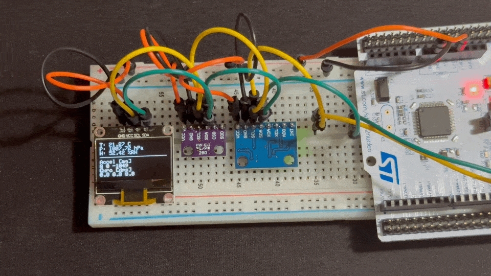
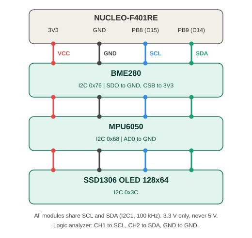
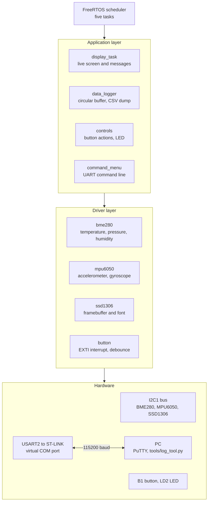
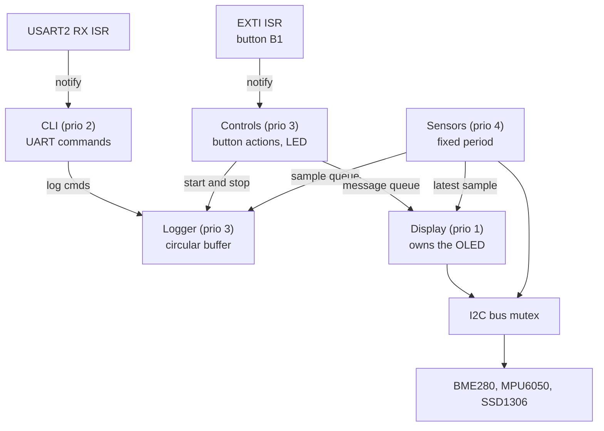
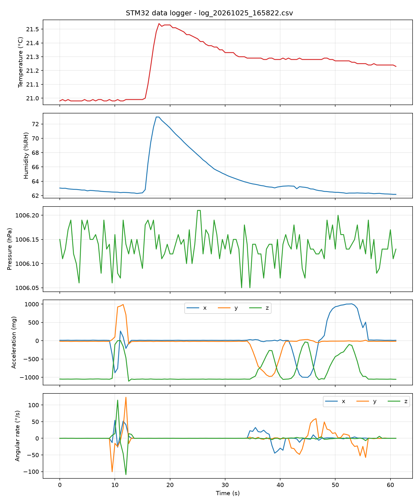
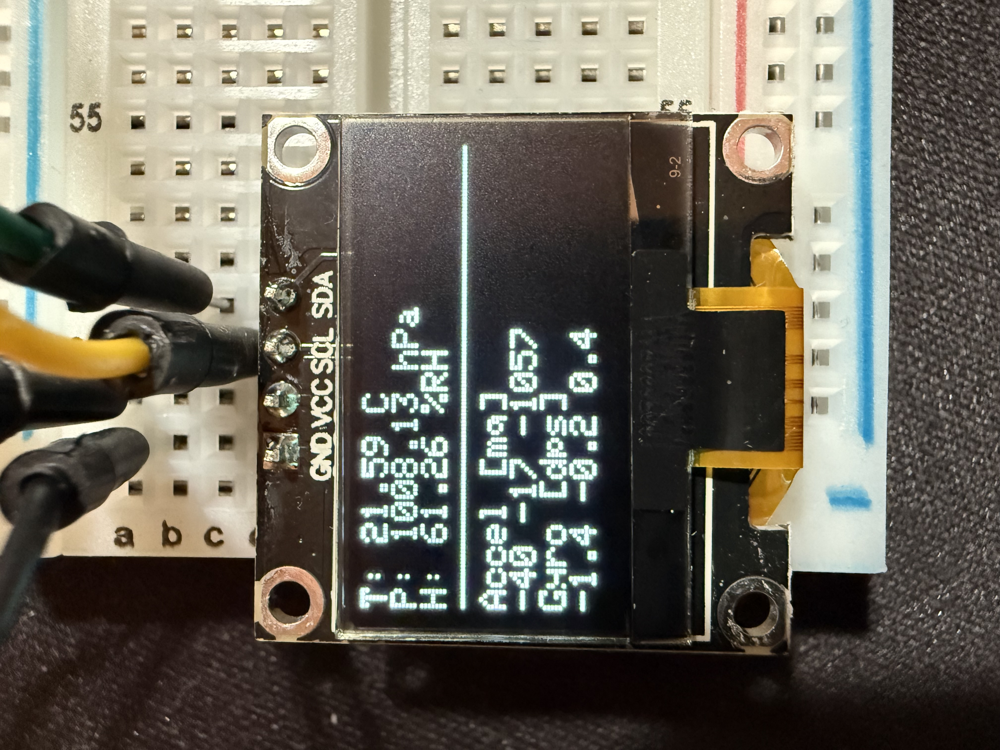
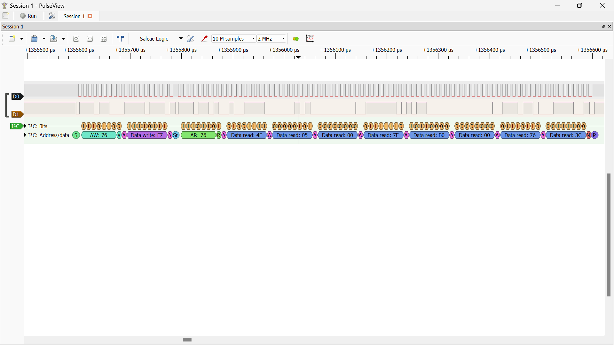
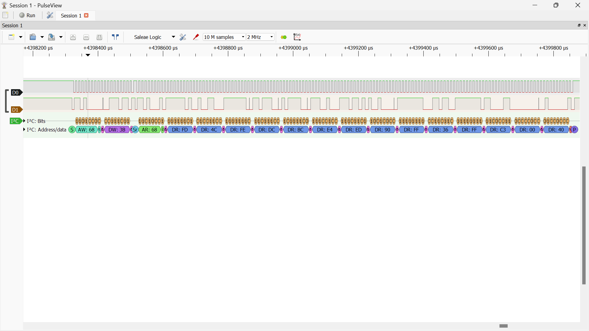

# STM32 Sensor Data Logger


Firmware for an STM32 Nucleo-64 board (NUCLEO-F401RE) that reads a BME280 environmental sensor and an MPU6050 IMU over I2C, shows the measurements on an SSD1306 OLED display, logs the data with timestamps to a buffer, and provides an interactive command interface over UART. A Python tool on the PC downloads the logs, saves them as CSV and plots them.

Written in C using the STM32 HAL, with each peripheral in its own driver module. It is a learning and portfolio project built step by step.

## Demo



A short press of the B1 button starts logging (LD2 turns on), the measurements update live on the display, and at the end the data is downloaded to the PC as a CSV with a plot.

## Hardware

| Component | Role | I2C address (7-bit) |
|---|---|---|
| NUCLEO-F401RE (ARM Cortex-M4) | Main board, on-board ST-LINK debugger and virtual COM port | |
| BME280 (HW-611 module) | Temperature, humidity, pressure | `0x76` |
| MPU6050 | 3-axis accelerometer and gyroscope | `0x68` |
| SSD1306 OLED 128x64 | Local measurement display | `0x3C` |
| 8-channel logic analyzer (Saleae-compatible, 24 MHz) | Protocol debugging with PulseView/sigrok | |

## Wiring



All three modules share the same I2C bus (I2C1, 100 kHz, with pull-ups on the modules).

| Signal | Nucleo pin | Goes to |
|---|---|---|
| SCL | PB8 (D15) | SCL of all modules |
| SDA | PB9 (D14) | SDA of all modules |
| 3V3 | 3.3V | VCC of all modules |
| GND | GND | GND of all modules |

Address pins: BME280 `SDO` to GND (0x76) and `CSB` to 3V3 (I2C mode). MPU6050 `AD0` to GND (0x68).

Other pins used: `LD2` on PA5 (logging LED), `B1` on PC13 (user button, interrupt) and USART2 on PA2/PA3 (ST-LINK virtual COM port, 115200 8N1).

## Project structure

```
Core/
  Inc/   main.h, command_menu.h, bme280.h, mpu6050.h, ssd1306.h, ssd1306_font.h,
         display_task.h, data_logger.h, button.h, controls.h, sensor_task.h, i2c_bus.h, app_config.h, sensor_math.h
  Src/   main.c, command_menu.c, bme280.c, mpu6050.c, ssd1306.c,
         display_task.c, data_logger.c, button.c, controls.c, sensor_task.c, i2c_bus.c, sensor_math.c
Drivers/            (auto-generated: STM32 HAL and CMSIS)
tools/              (log_tool.py, requirements.txt)
test/               (unit tests with Unity, Makefile)
.github/workflows/  (CI)
docs/               (screenshots, captures, example plot)
*.ioc               (STM32CubeMX configuration)
```

### Architecture diagram



Layered architecture:
- **Drivers**: `bme280`, `mpu6050`, `ssd1306`, `button`. They talk directly to the hardware.
- **Application**: `display_task` (live display), `data_logger` (circular buffer), `controls` (button actions), `command_menu` (UART).
- The FreeRTOS scheduler runs five tasks, and interrupts (UART RX, button) wake the tasks using task notifications (see the "FreeRTOS version" section).

## FreeRTOS version

The super-loop was replaced with FreeRTOS tasks (CMSIS-RTOS v2, HAL timebase on TIM11, 32 KB heap).



| Task | Priority | Stack (words) | Role |
|------|:---:|:---:|-------|
| Sensors | 4 | 256 | Reads the BME280 and MPU6050 at a fixed period (deadline-based) |
| Logger | 3 | 192 | Consumes the sample queue, circular buffer of 1024 records |
| Controls | 3 | 192 | Woken by the B1 interrupt, short/long press |
| CLI | 2 | 256 | Processes UART commands |
| Display | 1 | 256 | Sole owner of the framebuffer and the display |

Design decisions:
- **Task notifications from ISRs** (`vTaskNotifyGiveFromISR`) for the button and the UART: no polling and no missed events.
- **Sample queue** (16 slots) from Sensors to Logger, with a counter for dropped samples.
- **I2C bus mutex** (`i2c_bus.c`): three devices share the same bus from different tasks.
- **One display, one task**: the other tasks send messages through a queue, without blocking.
- The interrupt priorities (USART2, EXTI) are set less urgent than the FreeRTOS threshold, so that `...FromISR` calls are allowed.

### Measurements

Sampling period jitter, 50 ms period, 40 s recording:

| | mean | std | min | max |
|---|---:|---:|---:|---:|
| Super-loop | 55.6 ms | 22.9 ms | 50 ms | 150 ms |
| FreeRTOS | 50.0 ms | 0.0 ms | 50 ms | 50 ms |

In the super-loop, the display refresh (~100 ms over I2C) delayed sampling. With FreeRTOS the display has a lower priority and the Sensors task preempts it.

Stack usage (`rtos` command, minimum free space in words): CLI 606, Sensors 248, Display 346, Controls 482, Logger 206, Tmr Svc 214, IDLE 95. The initial sizes (384/256/512/768/512) were far too large and were reduced to the values in the table above, keeping ≥35% headroom (a little more for Logger and Controls).

### What I learned
Creating mutexes and queues before the scheduler starts leaves interrupts masked, and `HAL_Delay` hangs (I saw it stuck in `HAL_GetTick` in the debugger). Fix: create the objects inside a bootstrap task.

## Unit tests and CI

The pure math logic (BME280 compensation, register parsing, MPU6050 scaling) lives in `sensor_math.c`, which does not depend on the HAL or FreeRTOS. This way it compiles both into the firmware and into the tests that run on the PC.

```
make -C test
```

The tests (Unity, 17 cases) cover:
- Parsing of the calibration registers (including H4/H5, which share a register, and negative values) and of the raw data.
- The example from the Bosch datasheet (BMP280: 25.08 °C, 100653 Pa, same temperature and pressure formulas).
- Comparison of the integer computation against the datasheet's floating-point version over a realistic range of values (difference at most 0.01 °C, 1 Pa, 0.01 %RH).
- Edge cases: P1 = 0 (division by zero), humidity clamping at 0 and 100 %, full-scale accel and gyro, negative values.

The tests are compiled with `-Wall -Wextra -Werror` and with AddressSanitizer and UBSan. GitHub Actions (`.github/workflows/ci.yml`) runs the tests and cppcheck on every push and pull request.

## Current status

- [x] Toolchain: STM32CubeMX 6.18.1 + STM32CubeIDE 2.2.0
- [x] NUCLEO-F401RE bring-up (flash, debug, virtual COM port)
- [x] UART command interface (interrupt-driven RX, `printf` to USART2)
- [x] BME280 driver: calibration, compensation to temperature, pressure and humidity
- [x] MPU6050 driver: range and filter configuration, scaling to g and °/s, gyroscope offset calibration
- [x] I2C bus scan command
- [x] I2C traffic verified with a logic analyzer (BME280 and MPU6050)
- [x] SSD1306 driver with a 5x7 font and live display of measurements
- [x] Data logger: circular buffer of 1024 timestamped records with CSV export
- [x] Interrupt-driven B1 button: short press to start/stop logging, long press for calibration
- [x] Python tool to download, save as CSV and plot the log
- [x] Unit tests on the PC (Unity), GitHub Actions and cppcheck
- [x] Port to FreeRTOS: tasks, queues, I2C mutex, stack and jitter measurements

Ideas for future work: persistent storage (SD card or flash), event markers in the log, I2C at 400 kHz, I2C with DMA/interrupts instead of polling, low power.

## UART command interface (115200, 8N1)

| Command | Description |
|---|---|
| `help` | Shows the list of commands |
| `led on` / `led off` | Controls the LD2 LED |
| `status` | Shows the system tick (ms) |
| `scan` | Scans the I2C bus and shows the addresses that respond |
| `bme` | Raw BME280 pressure, temperature and humidity values |
| `env` | Temperature (°C), pressure (hPa) and humidity (%RH) |
| `mpu` | Raw MPU6050 accelerometer and gyroscope values |
| `imu` | Acceleration (mg), angular rate (°/s) and chip temperature |
| `mpucal` | Gyroscope calibration (the board must be stationary) |
| `log start [ms]` | Starts logging (default 1000 ms) |
| `log stop` | Stops logging |
| `log status` | Status: running or not, period, number of records, errors |
| `log dump` | Prints the records as CSV |
| `log clear` | Clears the buffer |

## B1 button

| Press | Action |
|---|---|
| Short | If not logging: clears the buffer and starts logging. If logging: stops it. |
| Long (1 s) | Gyroscope calibration, only when not logging |

The LD2 LED stays on while logging is running, and the display shows short messages for each action. The button is read with an EXTI interrupt on both edges, with a 30 ms debounce: the interrupt only records timestamps and wakes the Controls task, which decides whether it was a short or a long press. While the button is held, Controls also checks it every 50 ms, so a long press is reported after 1 s without waiting for the release.

## Data logging

The data logger keeps up to 1024 records of 28 bytes each (about 28 KB of RAM) in a circular buffer. When it is full, the oldest record is overwritten. The data stays in RAM, so it is lost on reset.

Format of the CSV printed by `log dump`:

| Column | Unit |
|---|---|
| `t_ms` | time since boot (ms) |
| `temp_c` | °C |
| `press_hpa` | hPa |
| `hum_pct` | %RH |
| `ax_mg`, `ay_mg`, `az_mg` | mg |
| `gx_dps`, `gy_dps`, `gz_dps` | °/s |

All measurements are computed and stored as integers (fixed point), without `float`. With the newlib-nano used by CubeIDE, `printf("%f")` is not supported without a special linker setting.

## Python tool

`tools/log_tool.py` runs on the PC and talks to the board over the COM port.

```bash
pip install -r tools/requirements.txt

# Record for 60 seconds with a sample every 500 ms, save as CSV and plot
python tools/log_tool.py record --port COM3 --period 500 --duration 60

# Download whatever data is already on the board
python tools/log_tool.py dump --port COM3

# Plot an existing CSV
python tools/log_tool.py plot logs/log_20261101_120000.csv
```

The CSV is saved automatically to `logs/log_<date_time>.csv`, with the plot next to it as a `.png`. PuTTY or any other program using the COM port must be closed.



## SSD1306 display

The display refreshes once per second and shows the measurements from both sensors:



Layout (8 lines of 21 characters):

```
T: 21.05 C
P: 1009.31 hPa
H: 61.18 %RH
-----------------
Accel [mg]
-41 -22 -1057
Gyro [dps]
-0.0 -0.0 -0.0
```

The driver keeps a 1024-byte framebuffer in RAM. The drawing functions only modify the framebuffer, and `SSD1306_Update()` sends it to the display page by page over I2C (about 100 ms at 100 kHz).

## I2C verification with a logic analyzer

The reads were captured with a Saleae-compatible logic analyzer and decoded in PulseView (SCL on D0, SDA on D1, 2 MHz sample rate).

### BME280



The decoded transaction matches the burst read in `BME280_ReadRaw()`:

1. Start, then address `0x76` with the write bit, and the sensor responds with ACK
2. Register pointer `0xF7` (start of the data registers)
3. Repeated start, then address `0x76` with the read bit
4. Eight data bytes (pressure 3, temperature 3, humidity 2), each with ACK
5. NACK on the last byte, then stop

### MPU6050



The transaction matches the burst read in `MPU6050_ReadRaw()`:

1. Start, then address `0x68` with the write bit, and the sensor responds with ACK
2. Register pointer `0x3B` (`ACCEL_XOUT_H`, start of the data registers)
3. Repeated start, then address `0x68` with the read bit
4. Fourteen data bytes (acceleration 6, temperature 2, gyroscope 6), each with ACK
5. NACK on the last byte, then stop

## Build and flash

1. Open the `.ioc` file in STM32CubeMX and run Generate Code with the STM32CubeIDE toolchain.
2. Open the project in STM32CubeIDE (File, Open Projects from File System).
3. Build, then Debug to flash the board through the on-board ST-LINK.
4. Open a serial terminal on the ST-LINK virtual COM port at 115200 8N1 and press the board's RESET button.

Note: since STM32CubeIDE 2.0, STM32CubeMX is a separate application. Pin and peripheral changes are made in CubeMX, not inside the IDE.

## Notes

- The HW-611 board is sold as both BME280 and BMP280. The BME280 has humidity, the BMP280 does not. The driver checks the chip ID (`0x60` for BME280, `0x58` for BMP280) at startup.
- The MPU6050 is configured for ±2 g and ±250 °/s, with a 100 Hz sample rate and a low-pass filter of about 44 Hz. The ranges are changed in `MPU6050_Init()` together with the corresponding scaling constants.
- The MPU6050 temperature is the chip temperature and usually reads a few degrees above the air. Ambient temperature comes from the BME280.
- During `log dump` the buffer is frozen so the CSV is consistent: samples taken while it prints (a few seconds for a full buffer) are not stored and are counted as dropped samples in `log status`. Sampling and the display keep running.
- Each display refresh takes about 100 ms, but the display runs in the lowest-priority task, so it no longer affects sampling timing (see Measurements). The minimum logging period is 20 ms.
